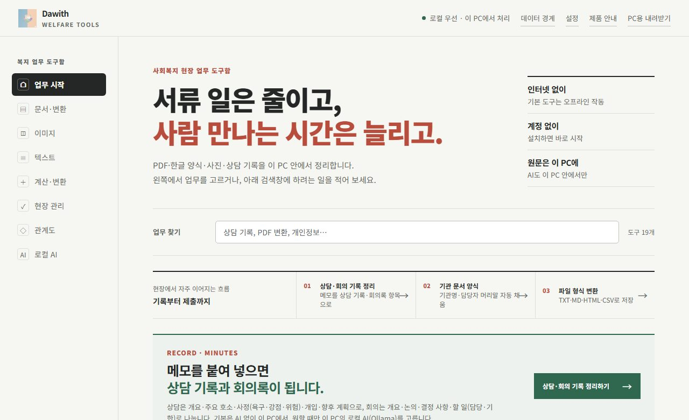
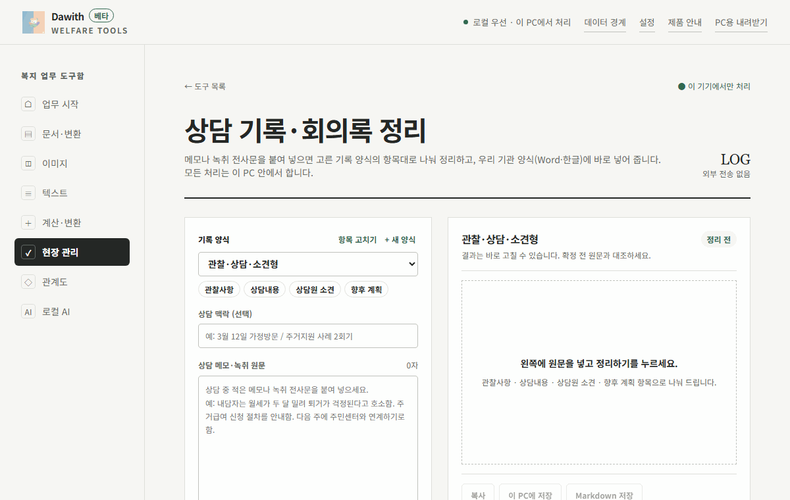
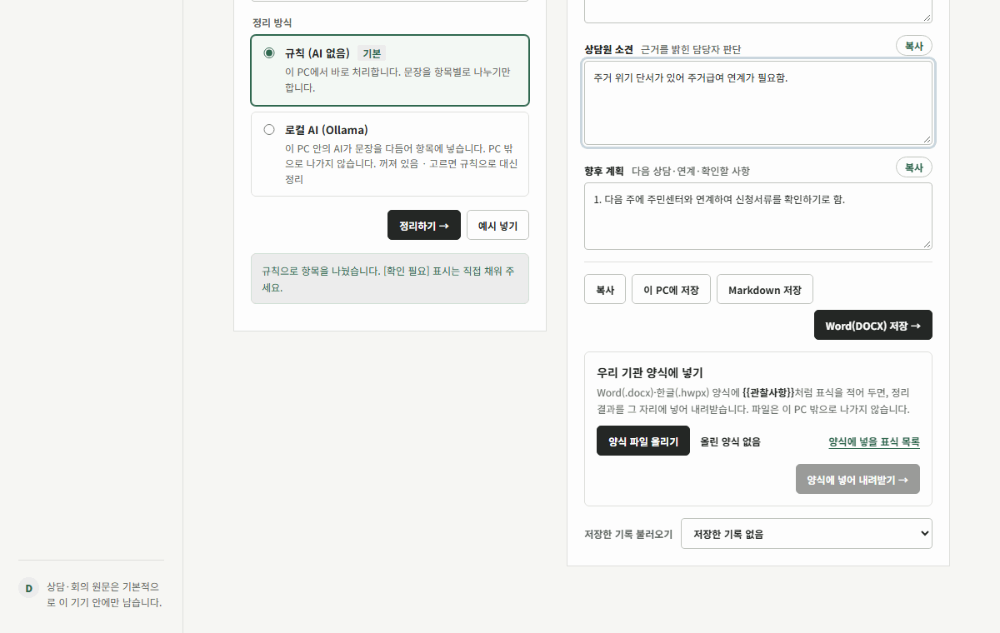
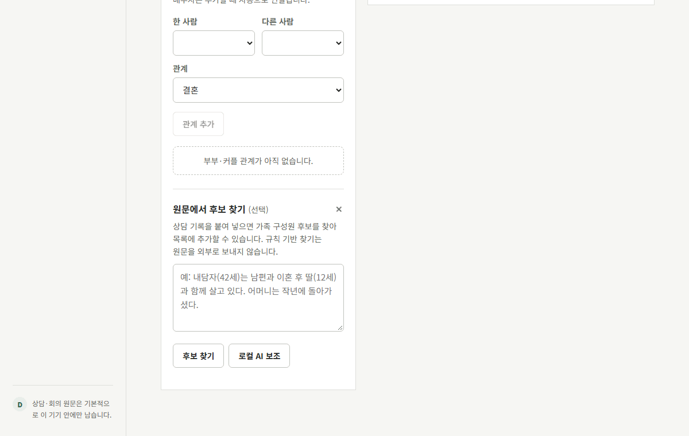
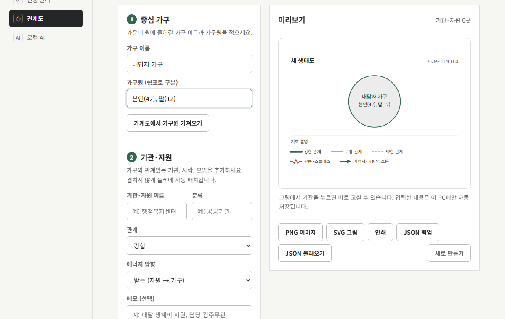
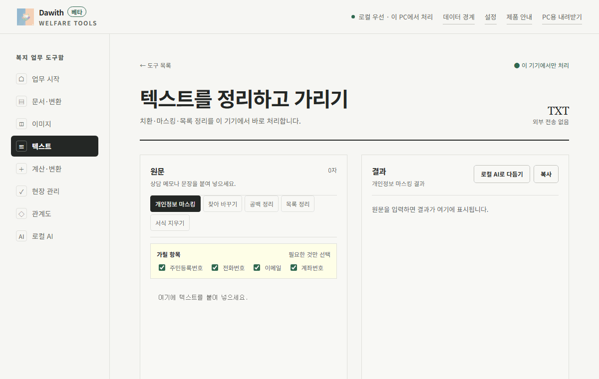
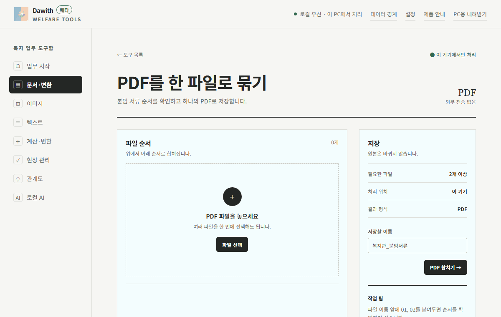
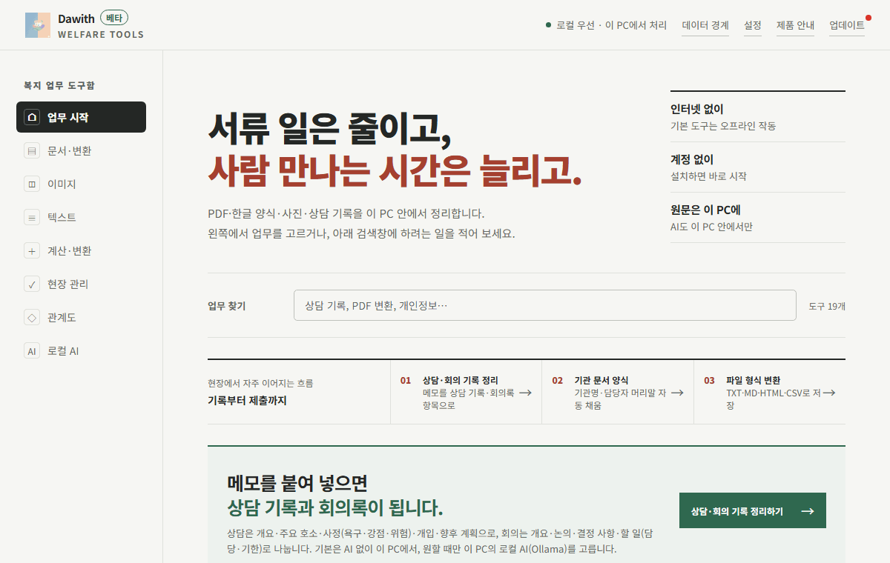

<p align="center">
  
</p>

<h1 align="center">Dawith 복지 업무 도구함</h1>

<p align="center">
  사회복지사가 매일 하는 서류 일을 인터넷 없이 내 PC에서 끝내는 무료 데스크톱 앱
</p>

<p align="center">
  <a href="https://github.com/dawith-ai/dawith-welfare-office/releases/latest"></a>
  
  
  <a href="LICENSE"></a>
</p>

<p align="center">
  <a href="https://github.com/dawith-ai/dawith-welfare-office/releases/latest"><b>Windows</b></a> ·
  <a href="https://github.com/dawith-ai/dawith-welfare-office/releases/latest"><b>Mac (Apple Silicon)</b></a> ·
  Linux (준비 중) ·
  <a href="https://dawith-ai.github.io/dawith-welfare-office/">제품 안내 사이트</a>
</p>

<p align="center">
  
</p>

---

## 기능

### 상담 기록·회의록 정리

메모를 붙여 넣고 양식(기본 상담기록, 관찰·상담·소견형, 사례회의록, 일반 회의록)을 고르면 항목별로 나눠 줍니다. 결과는 항목별로 보거나 한 번에 보고, 상자마다 복사 버튼으로 바로 붙여 넣을 수 있습니다. 기본은 AI 없이 규칙으로 나누고, 원하면 이 PC 안의 로컬 AI(Ollama)로 다듬습니다.



### 기관 양식 파일에 채우기

쓰던 Word(.docx)·한글(.hwpx) 양식에 `{{관찰사항}}` 같은 표식을 적어 올리면, 어떤 칸에 무엇이 들어갈지 먼저 보여 주고 그대로 채워 내려받습니다. 양식 파일은 PC 밖으로 나가지 않습니다.



### 가계도

가족 이야기를 붙여 넣으면 사람과 관계 후보를 찾아 표준 기호(사망·이혼·동거·함께 사는 가족)로 그립니다. 그림에서 사람을 눌러 바로 고치고 PNG·SVG로 저장합니다.



### 생태도

기관·자원과 관계의 세기(강함·보통·약함·갈등), 에너지 방향만 고르면 겹치지 않게 둘레에 배치합니다.



### 개인정보 가리기

공유하기 전에 붙여 넣기만 하면 전화번호·이메일·주민등록번호·계좌번호를 바로 가립니다. 이름처럼 규칙으로 찾기 어려운 정보는 찾아 바꾸기로 처리합니다.



### PDF 합치기·나누기

붙임 서류를 순서대로 올려 하나의 PDF로 묶거나, 필요한 쪽만 나눕니다. 모두 이 PC 메모리에서 처리합니다.



### 앱 안에서 업데이트

새 버전이 나오면 업데이트 버튼에 빨간 점이 뜹니다. 달라진 점을 확인하고 누르면 내려받은 뒤 자동으로 설치합니다. 최신 버전이면 그렇다고 알려 줍니다.



### 그 밖에

- 한글(HWP·HWPX) 문단·표 텍스트 확인, HWPX 표식 치환 저장 ([rhwp](https://github.com/edwardkim/rhwp), MIT)
- 기관 문서 양식: 기관명·담당자를 한 번만 적으면 회의록·사업계획서·결과보고서 머리말 자동 채움
- 파일 형식 변환 (TXT·MD·HTML·CSV)
- 이미지 크기 조절·용량 줄이기·회전·자르기, 사진 위치·촬영정보 지우기
- 만나이·날짜 기간 계산, 금액 한글 표기 (지출결의서)
- 식사·프로그램 인원 체크, 당직 일정표, 명단 CSV 저장
- 로컬 AI 설정: PC 사양(메모리·CPU)을 보고 알맞은 Ollama 모델을 추천

## 설치

| 운영체제 | 파일 | 비고 |
| --- | --- | --- |
| Windows 10·11 (64비트) | `Dawith-Welfare-Office-<버전>-x64-Setup.exe` | 대부분은 이것. 바탕화면·시작 메뉴에 등록 |
| Windows (설치 없이) | `Dawith-Welfare-Office-<버전>-x64-Portable.exe` | 설치 권한이 없는 PC, USB |
| Mac (Apple Silicon) | `Dawith.Welfare.Office-<버전>-arm64.dmg` | M1~M4. Intel Mac은 지원하지 않음 |
| Linux | 준비 중 | |

[Releases](https://github.com/dawith-ai/dawith-welfare-office/releases/latest)에서 내려받습니다. 코드 서명이 아직 없어 Windows가 경고를 띄울 수 있습니다. 막히면 [설치 도움말](https://dawith-ai.github.io/dawith-welfare-office/install.html)을 보세요.

## 데이터 경계

- 파일과 기록은 Dawith 서버에 올라가지 않습니다. 저장 데이터는 `%APPDATA%\Dawith Welfare Office\data`에 암호화해 둡니다.
- 로컬 AI를 고른 경우에만 입력이 `127.0.0.1`의 Ollama로 전달됩니다. 클라우드 AI로 보내는 경로는 없습니다.
- 앱이 인터넷에 연결하는 경우는 GitHub 업데이트 확인·내려받기, 한글 엔진(WASM) 첫 다운로드, Ollama 모델 다운로드뿐이며 작성한 내용은 담기지 않습니다.
- 자세한 내용은 [개인정보처리방침](https://dawith-ai.github.io/dawith-welfare-office/privacy.html)과 [데이터 처리 안내](https://dawith-ai.github.io/dawith-welfare-office/data-processing.html)에 있습니다.

## 개발

```bash
npm install
npm start            # http://127.0.0.1:4387
npm run check        # 문법 검사
npm test             # 단위 테스트
npm run test:e2e     # Playwright 브라우저 테스트
npm run dist:win     # Windows 경량 설치본 (dist-win/)
npm run release      # GitHub 릴리스 + site/release.json
node scripts/capture-feature-gifs.mjs   # 이 문서와 사이트의 기능 GIF 다시 찍기
```

Windows 설치본은 Electron 대신 Node 런타임과 Edge 앱 창을 써서 약 26MB입니다(`desktop/lite.mjs`). 제품 안내 사이트는 `site/`에 있고 main에 푸시하면 GitHub Pages로 배포됩니다.

## 문의·문제 알리기

불편한 점이나 바라는 기능은 [Issues](https://github.com/dawith-ai/dawith-welfare-office/issues)나 [제품 안내 사이트의 문의](https://dawith-ai.github.io/dawith-welfare-office/#contact)로 알려 주세요.

## 라이선스

[Apache-2.0](LICENSE). 함께 쓰는 오픈소스와 라이선스는 [제품 안내 사이트의 오픈소스 고지](https://dawith-ai.github.io/dawith-welfare-office/#oss)와 설치본의 `THIRD_PARTY_NOTICES.txt`에 정리되어 있습니다.
